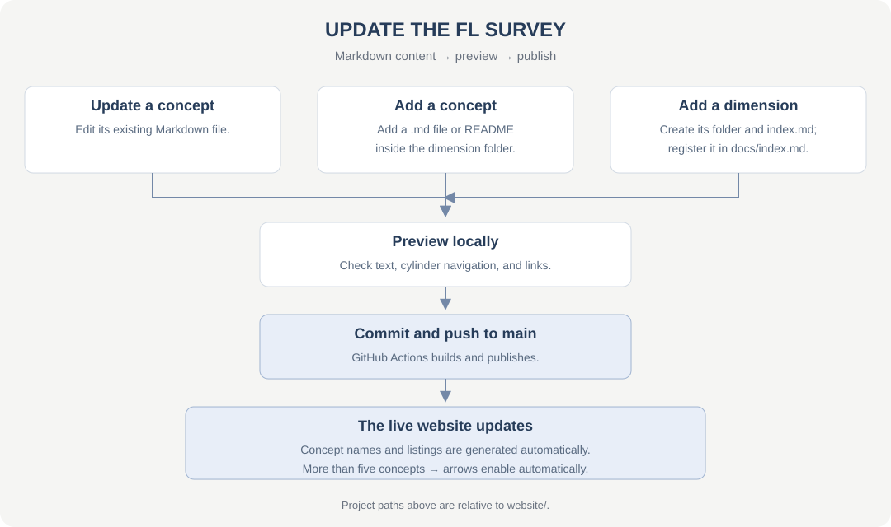

# Federated Learning Survey

A website for a comprehensive FL survey: visual concept navigation, research notes, paper summaries, and source references supporting PhD research in FL, secure FL, and applications.

**[Visit the website](https://syudu41.github.io/FL-survey/)** · [Website guide](website/README.md) · [Reference papers](ref-papers/README.md)

The MkDocs prototype uses placeholder concept notes. A simulator for comparing aggregation methods is planned.

## Content workflow

- **Update a concept:** edit its file in `website/docs/dimensions/<dimension>/`.
- **Add a concept:** create a `.md` file or README in that folder. Navigation and listings update automatically on rebuild.
- **Add a dimension:** create its folder and `index.md`, then register it in `website/docs/index.md`. It inherits the cylinder styling and controls.

Preview using the [website guide](website/README.md), then commit and push to `main`. GitHub Actions publishes the update. Each dimension shows up to five concepts; additional concepts enable the arrows.
